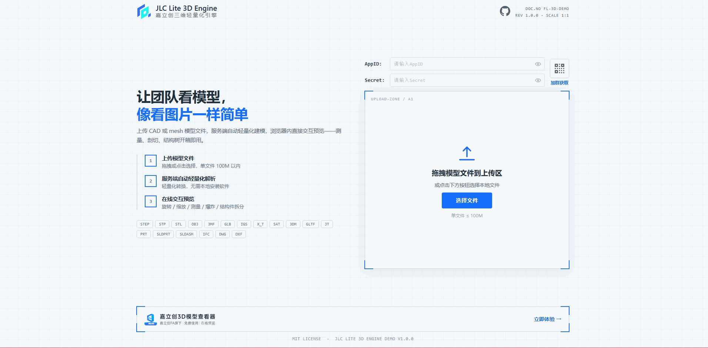
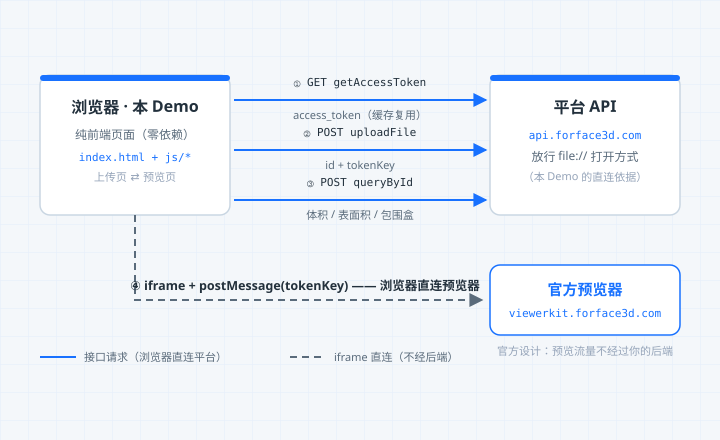

# 嘉立创三维轻量化引擎示例 Demo

[](./.github/workflows/ci.yml)
[](./LICENSE)

纯 **HTML + CSS + JavaScript** 实现的[嘉立创 Forface3D 开放平台的三维轻量化引擎](https://3dlite.forface3d.com/docs)接入示例 —— 零框架、零构建、零依赖，克隆下来改一个配置文件就能跑通「上传模型 → 在线轻量化 → 浏览器内 3D 预览」全链路。

适合第一次接入开放平台、想用最短路径理解接入流程的开发者。框架封装（Vue / React / SDK）请移步主仓库 [jlc-lite-3d-engine](https://github.com/Glaxyyy/jlc-lite-3d-engine)。



## 功能

- 📤 **拖拽 / 点击上传**模型文件（18 种格式，单文件 ≤ 100M），带平滑上传进度条
- ⚡ **上传即预览**：`tokenKey` 上传响应直接返回，无需等待服务端解析
- 🧊 **在线 3D 预览**：iframe 嵌入官方预览器（viewerkit），旋转 / 缩放 / 测量 / 爆炸开箱即用
- 📊 **模型信息面板**：后台轮询解析结果，展示体积、表面积、最小包围盒等几何属性
- 🛡️ **协议安全细节**：postMessage `event.source` 校验、就绪信号 2s 兜底重发、`deviceConfig` 显式下发

## 快速开始

### 1. 获取凭据

到开发者账户中心 [account.forface3d.com](https://account.forface3d.com)「我的应用」创建应用，拿到 **app_id** 和 **app_secret**。

### 2. 填写配置

复制 [js/config.example.js](js/config.example.js) 为同目录下的 `js/config.js`（该文件已被 git 忽略，真实凭据不会进仓库），再把两行占位换成你的凭据：

```bash
cp js/config.example.js js/config.js
```

```js
APP_ID: '在此填入你的AppID',
APP_SECRET: '在此填入你的AppSecret',
```

### 3. 启动

**方式一：双击 index.html（最快）**

直接把 index.html 拖进浏览器（或双击）即可上传、预览。原理：`file://` 页面发出的请求 Origin 为 `null`，平台放行了该来源。但这属于平台当前策略，后续若收紧则此方式失效——届时改用方式二。

**方式二：`node server.js`（推荐，行为与生产一致）**

```bash
node server.js
```

浏览器打开 <http://localhost:8080>，拖入一个 STEP / STL / OBJ 等模型文件即可预览。

> **为什么方式二多了一步？** 平台 API 未对 `http://localhost` 等常规网页来源开放跨域，浏览器直连会被拦截。[server.js](server.js) 用 Node **内置模块**（零依赖、无 npm install）做了两件事：静态文件服务 + 把 `/api/*` 转发给平台 API。这也更接近生产形态——生产环境请把 `js/api.js` 里的三个接口搬进你自己的后端，而不是依赖上述任何一种本地特例。

## 它是怎么工作的？

整个 Demo 只涉及 **3 个平台接口 + 1 套 iframe 协议**（详细参数见[官方文档站](https://3dlite.forface3d.com/docs) reference/ 与 guides/ 分册）：



三条关键规则（也是平台设计的精髓）：

1. **tokenKey 上传即得，预览不用等解析** —— 轻量化的等待由预览器内部消化，前端零轮询门槛
2. **`app_secret` 永远只该存在于后端**；`tokenKey` 不是密钥，它就是设计给 iframe 用的（2 小时有效）
3. **预览器 iframe 由浏览器直连平台**，不经过代理/后端，这是官方设计


## 目录结构

```
jlc-lite-3d-engine-demo/
├── index.html          # 页面结构（上传页 + 预览页两个视图）
├── server.js           # ⚙️ 零依赖本地服务器（静态文件 + /api 代理转发，Node 内置模块）
├── css/
│   └── style.css       # 工程蓝图风样式
├── js/
│   ├── config.example.js  # ⚙️ 配置模板（复制为 config.js 后填入 app_id / app_secret，config.js 已被 git 忽略）
│   ├── api.js          # 平台 3 个接口封装（token / 上传 / 查询）
│   ├── viewer.js       # 官方预览器 iframe + postMessage 协议封装
│   └── app.js          # 页面状态机与交互（上传 / 进度 / 预览 / 信息面板）
├── assets/             # 品牌图标
└── .github/            # CI 工作流 + Issue/PR 模板 + README 配图（architecture.svg）
```

代码按「配置 → 接口 → 协议 → 交互」四层拆分，每个文件都有逐段中文注释，建议按 `config.example.js → api.js → viewer.js → app.js` 的顺序阅读，总计约 700 行。

## 常见问题

<details>
<summary><b>请求平台接口报错 / 控制台出现 CORS 跨域报错</b></summary>

平台开放 API 的跨域策略：放行 `Origin: null`（双击以 `file://` 打开），**不放行** `http://localhost` 等常规网页来源。因此双击 index.html 可以跑通；请改用 `node server.js`（内置 `/api` 代理转发）。生产环境请把 `js/api.js` 里的三个接口搬到自己的后端（语言不限，就是普通的 HTTP 调用），前端只调你自己的接口。
</details>

<details>
<summary><b>把 app_secret 写在前端安全吗？</b></summary>

**不安全**。这只是为了让你零后端跑通流程的教学简化。任何人打开浏览器 DevTools 都能看到它，等于把密码公开。生产环境务必放后端 —— 平台侧也按此设计（`tokenKey` 例外，它 2 小时过期、仅对应单个任务，可下发前端）。
</details>

<details>
<summary><b>预览页停留超过 2 小时后空白 / 刷新后预览失效</b></summary>

`tokenKey` 有效期 2 小时。带着任务 `id` 调用「获取预览凭证」接口（reference/3.4）重取一个新 `tokenKey` 重新喂给 iframe 即可，本 Demo 未实现该增强，可作为练手任务。
</details>

<details>
<summary><b>上传报错 00001 / 10001</b></summary>

- `10001`：文件超过 100M 限制
- `00001`：大概率是文件名缺少格式扩展名（平台按扩展名识别文件类型），或中文文件名编码问题
</details>

<details>
<summary><b>预览器变成了移动端布局</b></summary>

iframe 宽度小于 768px 时预览器会自动切换移动端 UI。窄容器（侧栏 / 弹窗）场景请像本 Demo 一样显式下发 `options.deviceConfig: 'computer'`。
</details>

## 安全说明

`app_secret` 只在本地 `js/config.js`（被 git 忽略）中出现，**仅因教学需要**、不进仓库；请勿把真实凭据提交到任何公开仓库。漏洞报告流程见 [SECURITY.md](SECURITY.md)。

## 📚 官方文档

本 Demo 覆盖的只是最小接入链路。完整的接口参考（token / 上传 / 查询 / 凭证重取 / 临时链接 / 删除）、集成指南（iframe 协议 / Webhook / 自有后端）、支持格式与全局错误码说明，见[嘉立创三维轻量化引擎官方文档](https://3dlite.forface3d.com/docs)。

## 相关仓库

- [jlc-lite-3d-engine](https://github.com/Glaxyyy/jlc-lite-3d-engine) —— 官方开源 SDK + Vue 示例 + 服务端代理（含 Webhook 验签、token 缓存等生产级能力）

## 💬 联系我们

- **APP_ID / APP_SECRET 申请 / 使用咨询**：加入「嘉立创 Forface3D 技术交流群」（企业微信）

  

- **邮箱**：service@forface3d.com（二维码失效或不想加群时使用）
- **Bug / 功能建议**：提 [GitHub Issue](https://github.com/Glaxyyy/jlc-lite-3d-engine-demo/issues)
- **安全漏洞**：请勿公开提交，走 [Security Advisories](https://github.com/Glaxyyy/jlc-lite-3d-engine-demo/security/advisories)（见 [SECURITY.md](SECURITY.md)）

> ⚠️ 请勿在群里或任何公开渠道张贴 `app_secret` / token。

## License

[MIT](LICENSE)
